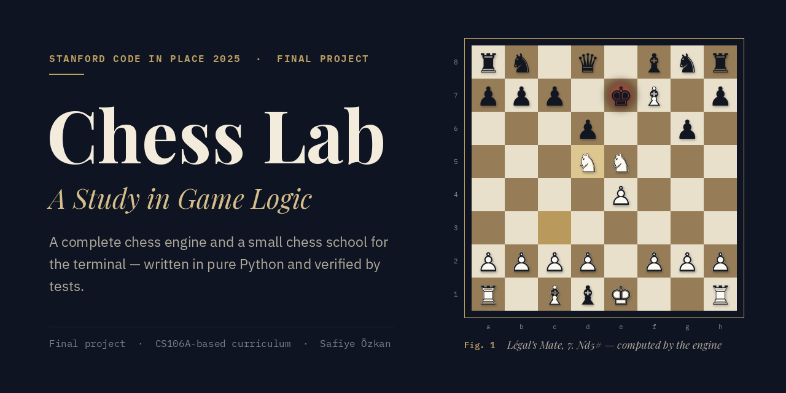
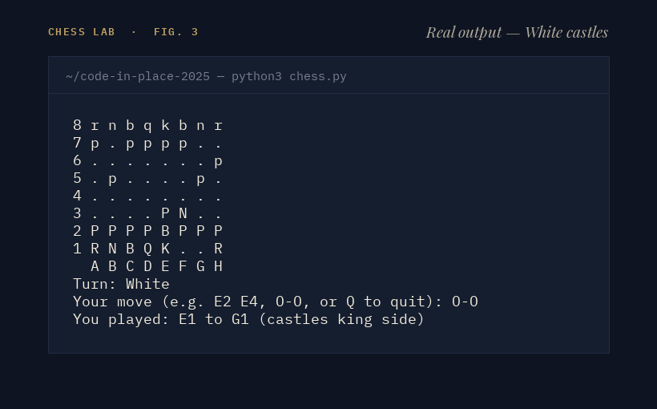
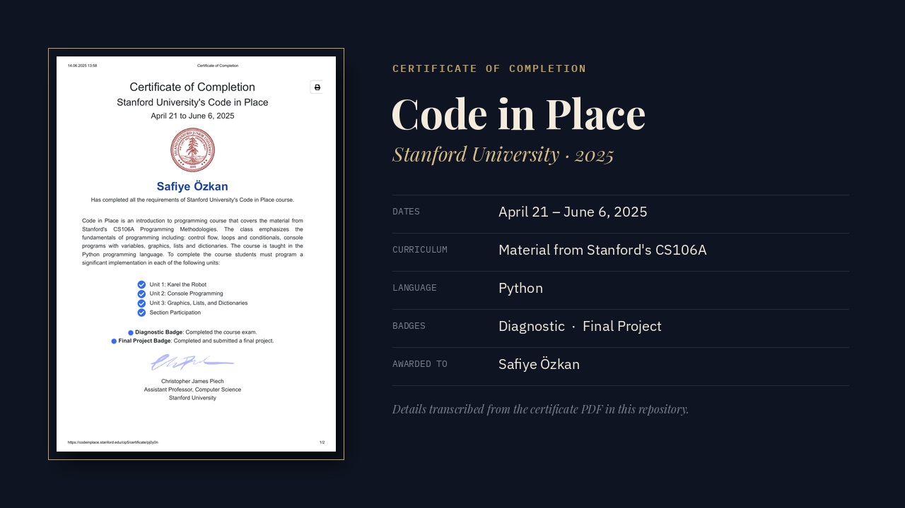
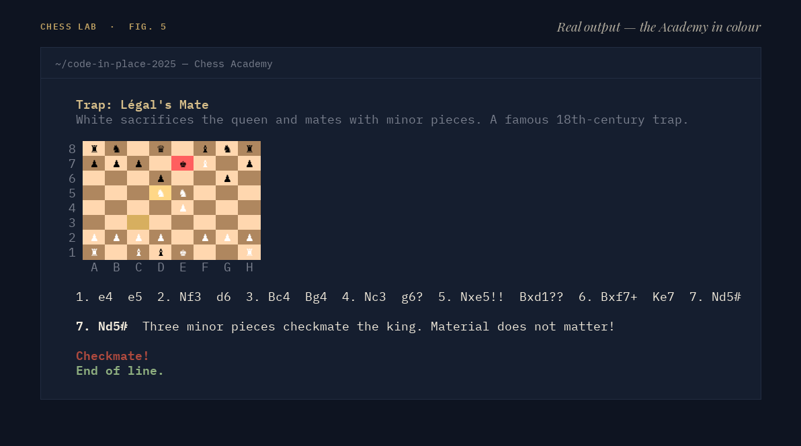
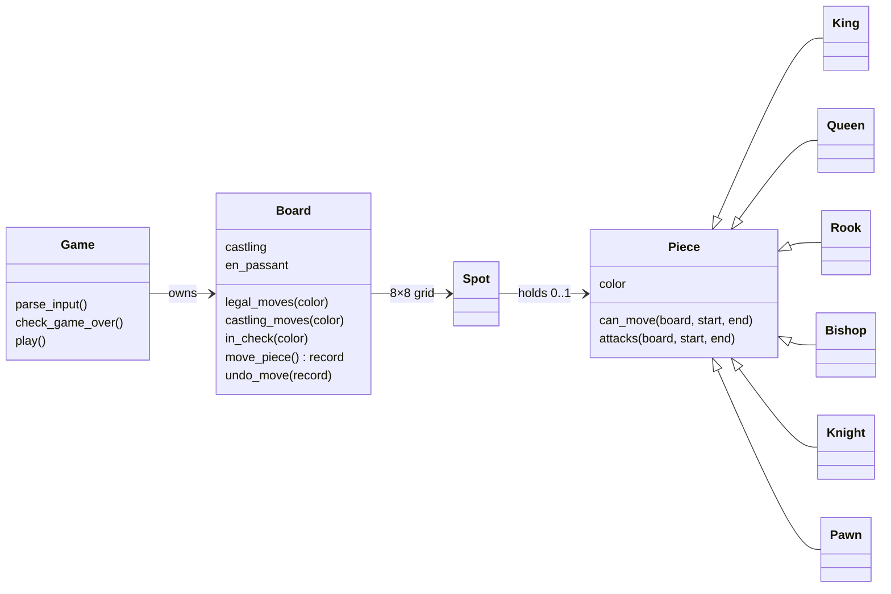

<p align="center">
  
</p>

<p align="center">
  <a href="#demo">Demo</a> &nbsp;·&nbsp;
  <a href="#stanford-code-in-place-2025">Stanford Code in Place</a> &nbsp;·&nbsp;
  <a href="#how-the-game-thinks">Game logic</a> &nbsp;·&nbsp;
  <a href="#run-it">Run it</a> &nbsp;·&nbsp;
  <a href="assets/certificate.pdf">Certificate</a>
</p>

<br>

**Chess Lab** is a complete game of chess that runs in your terminal, written in pure Python with no
third-party libraries. You play White against a computer opponent; every rule of chess is enforced,
including castling, en passant and promotion, and the game ends in checkmate or stalemate. A second
mode, the **Chess Academy**, replays famous openings and traps move by move and gives you puzzles to solve.

It began as my final project for **Stanford's Code in Place 2025**, and I have kept developing it since.

<br>

## Demo

<p align="center">
  
</p>

The animation is drawn by a script, but the moves are not scripted by hand: each one is checked
against the engine's list of legal moves, and the engine itself confirms the final checkmate.
Here is what the game actually looks like in a terminal:

<p align="center">
  
</p>

<br>

## Stanford Code in Place 2025

<p align="center">
  
</p>

[Code in Place](https://codeinplace.stanford.edu/) is a free, online introduction to programming run by
Stanford University. It teaches the material of Stanford's first programming course, **CS106A
Programming Methodologies**, in Python: Karel the Robot, console programming, graphics, lists and
dictionaries. I took part in the spring 2025 edition (April 21 – June 6, 2025), and this chess game was
the final project I submitted to complete the course.

> [!NOTE]
> This is an independent student project created as part of the course. It is not published,
> maintained or endorsed by Stanford University.

**Project history.** The course version had the six piece types and their movement rules, the board,
and a computer that plays a random move. That original state of the repository is preserved at
[commit `d843cca`](https://github.com/sayko89/code-in-place-2025/tree/d843cca) (June 2025).
In October 2026 I extended it with check and checkmate, castling, en passant, promotion, the Chess
Academy and a test suite. The object-oriented design from the original is unchanged.

<br>

## What it does

<table>
<tr><td width="30%"><b>Every rule of chess</b></td><td>Movement for all six pieces, captures, check, <b>checkmate</b> and <b>stalemate</b>, <b>castling</b> on both sides, <b>en passant</b> and <b>promotion</b> to any piece. Moves that would leave your own king in check — including moving a pinned piece — are rejected with an explanation.</td></tr>
<tr><td><b>Play the computer</b></td><td>You are White, the computer is Black. Type <code>E2 E4</code>, <code>O-O</code>, or <code>E7 E8 N</code> to promote to a knight.</td></tr>
<tr><td><b>Chess Academy</b></td><td>8 openings and 7 traps replayed move by move with a note on every move; 7 puzzles with hints; 10 principles for beginners.</td></tr>
<tr><td><b>Verified</b></td><td>22 automated tests, including <i>perft</i> checks against published reference counts. Every Academy line is replayed by the engine in the tests.</td></tr>
</table>

### The Chess Academy

<p align="center">
  
</p>

| Openings | Traps | Puzzles |
|---|---|---|
| Italian Game · Ruy Lopez · Sicilian Najdorf · French · Caro-Kann · Queen's Gambit Declined · King's Indian · London System | Fool's Mate · Scholar's Mate · Légal's Mate · Blackburne Shilling · Englund Gambit · Elephant Trap · Fishing Pole | Back-rank mate · Smothered mate · Scholar's finish · Royal fork · Skewer · En passant checkmate · Underpromotion |

In a colour terminal the Academy draws a shaded board, highlights the last move and marks a king in check:

<p align="center">
  
</p>

<br>

## How the game thinks

Deciding whether a move is legal happens in two steps.

**1. Can the piece move there?** Each piece class answers this for itself in `can_move(board, start, end)`:
a knight checks for an L-shape, a bishop for a clear diagonal (`Board.is_clear_path`), a pawn for one
step forward, two from its starting rank, a diagonal capture, or an en passant capture. Castling is
handled separately by `Board.castling_moves`, because it involves two pieces and has extra conditions:
neither piece may have moved, the squares between them must be empty, and the king may not be in check,
pass through an attacked square, or land on one.

**2. Is the king safe afterwards?** `Board.legal_moves` plays each candidate move on the real board,
asks `in_check`, and takes the move back. `move_piece` returns a small record of every square it changed
— plus the castling rights and the en passant square — so `undo_move` restores the exact position, even
after castling, en passant or a promotion.

```python
def legal_moves(self, color):
    return [m for m in self.pseudo_legal_moves(color) if self.leaves_king_safe(m, color)]
```

**How a game ends.** At the start of every turn the game counts the legal moves. None while in check is
**checkmate**; none while not in check is **stalemate**. The draw rules — threefold repetition, the
50-move rule and insufficient material — are not implemented yet.

**How I know it is right.** *Perft* is the standard test for chess move generators: from a position,
count every position reachable in *n* moves and compare with published numbers. If one rule were even
slightly wrong — say, castling through check — the totals would differ.

| Position | Tests | Depth | Expected | Chess Lab |
|---|---|:---:|---:|---:|
| Starting position | normal moves | 3 | 8,902 | 8,902 ✓ |
| "Kiwipete" | castling, pins, en passant | 2 | 2,039 | 2,039 ✓ |
| Rook-and-pawn endgame | en passant, discovered checks | 3 | 2,812 | 2,812 ✓ |
| Promotion position | promotions, castling rights | 2 | 264 | 264 ✓ |

<sub>Reference numbers: <a href="https://www.chessprogramming.org/Perft_Results">Chess Programming Wiki — Perft Results</a>.</sub>

<br>

## The computer player

The computer does not search or evaluate positions. On its turn it asks the engine for every legal move
and picks one **uniformly at random**; when a pawn promotes, it always chooses a queen.

```python
src, dest = random.choice(self.board.legal_moves(BLACK))
```

So it always plays a legal move and will deliver checkmate if it stumbles into one, but it does not
plan. It is an easy opponent — good for trying out the openings and traps from the Academy. A
minimax search with material evaluation is the natural next step (see the [roadmap](#roadmap)).

<br>

## Architecture



| File | Purpose |
|---|---|
| [`chess.py`](chess.py) | The engine (`Spot`, `Piece` and its six subclasses, `Board`), the game loop and the main menu |
| [`academy.py`](academy.py) | Academy screens: lesson viewer, puzzle trainer, principles; coloured board for terminals |
| [`lessons.py`](lessons.py) | Academy content as plain data: openings, traps, puzzles, principles |
| [`tests/`](tests) | Rule tests, perft tests, and a test that replays every lesson and puzzle |
| [`tools/make_assets.py`](tools/make_assets.py) | Renders the images in this README from the engine and from real program output |

<br>

## Technology

- **Python 3** and its standard library only — `random`, `sys`, `os` and `unittest`. Nothing to install.
- **Object-oriented design**: one class per piece, polymorphic `can_move`.
- **Pillow** and **poppler** are used only by `tools/make_assets.py` to draw the README images; the game does not need them.

<br>

## Run it

You need Python 3.

```bash
git clone https://github.com/sayko89/code-in-place-2025.git
cd code-in-place-2025
python3 chess.py
```

Choose **1** to play or **2** for the Chess Academy.

| To… | Type |
|---|---|
| move a piece | `E2 E4` |
| castle king side / queen side | `O-O` / `O-O-O` |
| promote a pawn | `E7 E8` and pick a piece, or `E7 E8 N` |
| quit | `Q` |

Run the tests:

```bash
python3 -m unittest discover tests
```

<br>

## What I learned

- **Let each object answer its own question.** Giving every piece its own `can_move` kept the rules
  small and readable, and adding new behaviour later (pawn attacks, en passant) meant changing one class.
- **"Can it move there?" and "Is the move legal?" are different questions.** Separating them is what made
  check, pins and checkmate possible without rewriting the pieces.
- **Every change must be reversible.** Trying a move and taking it back only works if *all* state —
  captured pieces, castling rights, the en passant square — is restored. Returning a record from
  `move_piece` made that reliable.
- **Test against known answers.** Perft numbers caught mistakes that playing a few games never would.

<br>

## Roadmap

- [x] Check, checkmate and stalemate
- [x] Castling, en passant and promotion
- [x] Chess Academy
- [x] Tests, including perft
- [ ] Draw rules: threefold repetition, 50-move rule, insufficient material
- [ ] A computer player that searches (minimax with material evaluation)

<br>

## Certificate and attribution

- **Certificate:** [assets/certificate.pdf](assets/certificate.pdf) ·
  [verify on the Code in Place site](https://codeinplace.stanford.edu/cip5/certificate/pj0y0n)
- Code in Place is a program of Stanford University. This repository is my own independent work and is
  not affiliated with or endorsed by Stanford.
- README typefaces: [Playfair Display](https://github.com/clauseggers/Playfair-Display) and
  [IBM Plex](https://github.com/IBM/plex), both under the SIL Open Font License (see [`tools/fonts`](tools/fonts)).
  Chess pieces are drawn with [DejaVu](https://dejavu-fonts.github.io/) glyphs.
- Perft reference numbers from the [Chess Programming Wiki](https://www.chessprogramming.org/Perft_Results).

<br>

<p align="center"><sub>Chess Lab · Safiye Özkan · Code in Place 2025</sub></p>
