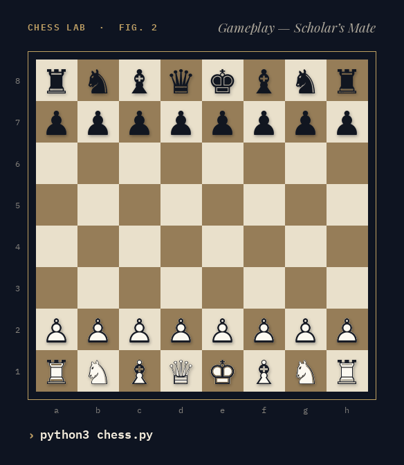
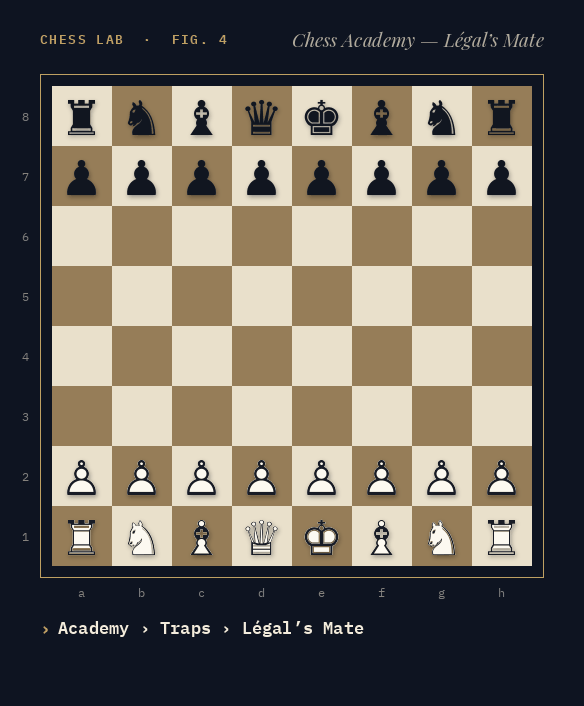
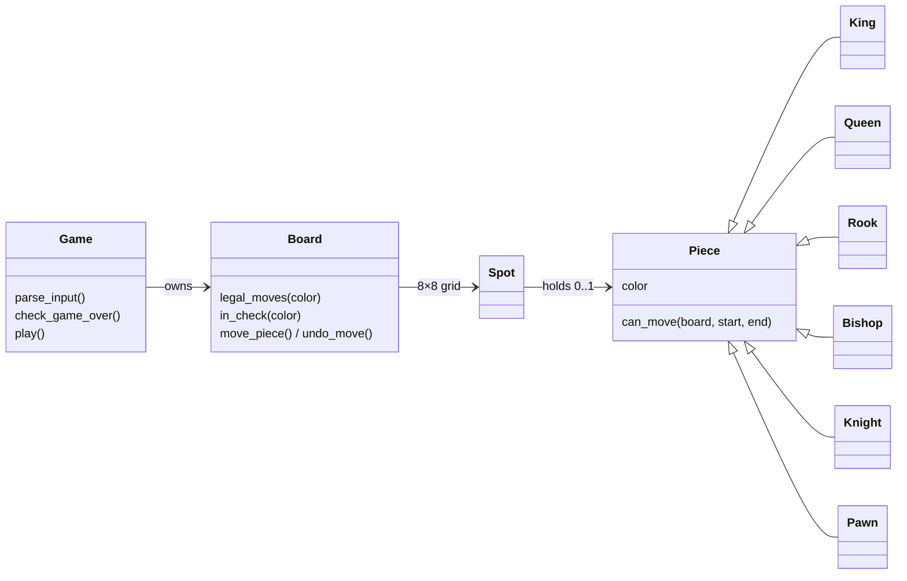

<div align="center">

# ♞ Terminal Chess

**A chess game and chess school in the terminal, written in pure Python — my final project for Stanford's Code in Place 2025.**

[](https://www.python.org/)
[](#-quick-start)
[](tests/test_lessons.py)
[](https://codeinplace.stanford.edu/)



<sub>Every move in this animation is validated by the game's own engine — see <a href="tools/make_demo_gif.py"><code>tools/make_demo_gif.py</code></a>.</sub>

</div>

---

## ✨ Features

|   |   |
|---|---|
| ♟️ **Full piece movement** | All six piece types, including the pawn's double step from its starting rank |
| 🚧 **Path checking** | Rooks, bishops and queens can't jump over other pieces |
| 👑 **Check & checkmate** | The game announces check, detects checkmate and ends with a winner |
| 🤝 **Stalemate** | No legal moves without being in check is correctly called a draw |
| 📌 **Pins respected** | Any move that would leave your own king in check is rejected |
| 🏰 **Castling** | King and queen side, with every rule: no castling out of, through or into check |
| 👻 **En passant** | Capture a pawn that just made a double step — only on the very next move |
| 🔄 **Promotion** | Promote to a queen, rook, bishop or knight |
| 🤖 **Computer opponent** | Plays Black by choosing a random legal move |
| 🎓 **Chess Academy** | Openings, traps, puzzles and principles — see below |

## 🚀 Quick start

```bash
git clone https://github.com/sayko89/code-in-place-2025.git
cd code-in-place-2025
python3 chess.py
```

Pick **1** to play against the computer or **2** for the Chess Academy.
Type moves as `<from> <to>` — for example `E2 E4`.

| You want to… | Type |
|---|---|
| Move a piece | `E2 E4` |
| Castle king side / queen side | `O-O` / `O-O-O` (or move the king two squares: `E1 G1`) |
| Promote a pawn | `E7 E8` — you'll be asked which piece, or type it directly: `E7 E8 N` |
| Quit | `Q` |

```text
8 r n b q k b n r
7 p p p p p p p p
6 . . . . . . . .
5 . . . . . . . .
4 . . . . P . . .
3 . . . . . . . .
2 P P P P . P P P
1 R N B Q K B N R
  A B C D E F G H
Turn: Black
Computer played: G8 to F6
```

<sub>Uppercase = White, lowercase = Black · <b>K</b> king · <b>Q</b> queen · <b>R</b> rook · <b>B</b> bishop · <b>N</b> knight · <b>P</b> pawn</sub>

## 🎓 Chess Academy

Choose **2** in the main menu to open the Academy — a small chess school inside the game.
Every line is replayed move by move on a real board, with a note explaining the idea behind each move.

<div align="center">

</div>

<table>
<tr>
<td valign="top" width="25%">

**📖 Openings**

- Italian Game
- Ruy Lopez
- Sicilian Najdorf
- French Defence
- Caro-Kann
- Queen's Gambit Declined
- King's Indian
- London System

</td>
<td valign="top" width="25%">

**🪤 Traps**

- Fool's Mate
- Scholar's Mate
- Légal's Mate
- Blackburne Shilling
- Englund Gambit Trap
- Elephant Trap
- Fishing Pole Trap

</td>
<td valign="top" width="25%">

**🧩 Puzzles**

- Back-rank mate
- Smothered mate
- Scholar's finish
- Royal fork
- Skewer
- En passant checkmate
- Underpromotion

<sub>Type your move, ask for a hint, or reveal the solution.</sub>

</td>
<td valign="top" width="25%">

**💡 Principles**

10 rules of thumb — control the center, develop, castle early, watch f7…

</td>
</tr>
</table>

In a real terminal the Academy uses a coloured board with chess glyphs and highlights the last move and a king in check.
Every opening, trap and puzzle is checked by the test suite, so the Academy can only show moves the engine accepts.

## 🧩 How it works



Each piece only knows its own movement pattern (`can_move`). The `Board` turns those into **legal** moves by
playing every candidate move, checking whether the mover's king is attacked, and undoing it. If a player has no
legal moves, the game ends: **checkmate** when the king is in check, **stalemate** otherwise.

```text
chess.py              engine + game loop + main menu
academy.py            Chess Academy screens (lesson viewer, puzzles, tips)
lessons.py            lesson content: openings, traps, puzzles, principles
tests/                unit tests — rules, perft counts and every Academy line
tools/make_demo_gif.py  renders the GIFs in this README
```

The rules are verified with **perft** tests: from several well-known positions the test suite counts every
position reachable a few moves deep (e.g. 8,902 after three plies from the start) and compares the totals with
published reference numbers. A single wrong rule — castling, en passant or promotion — would change the count.

Run the tests with:

```bash
python3 -m unittest discover tests
```

## 🗺️ Roadmap

- [x] Check, checkmate and stalemate detection
- [x] Castling, en passant and pawn promotion
- [ ] A smarter opponent (minimax with material evaluation)
- [x] Chess Academy: openings, traps, puzzles and principles
- [x] Unit tests for the engine and every lesson
- [ ] Draw rules: threefold repetition, 50-move rule, insufficient material

## 📜 Certificate

Completed **Stanford's Code in Place 2025** (based on CS106A) —
[verified certificate](https://codeinplace.stanford.edu/cip5/certificate/pj0y0n) · [PDF](assets/certificate.pdf)

---

<div align="center">
<sub>Made with ♥ and Python by <a href="https://github.com/sayko89">Safiye Özkan</a></sub>
</div>
