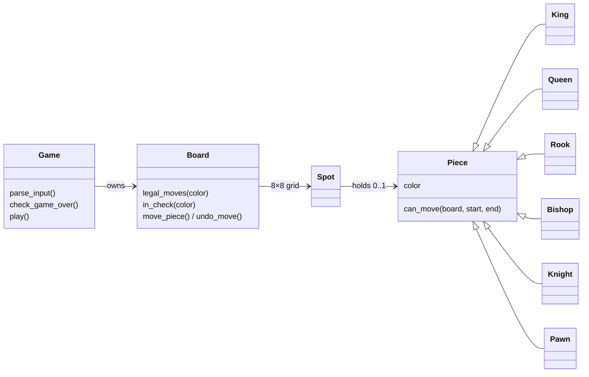

<div align="center">

# ♞ Terminal Chess

**A chess game in the terminal, written in pure Python — my final project for Stanford's Code in Place 2025.**

[](https://www.python.org/)
[](#-quick-start)
[](https://codeinplace.stanford.edu/)


<sub>Every move in this animation is validated by the game's own engine — see <a href="tools/make_demo_gif.py"><code>tools/make_demo_gif.py</code></a>.</sub>

</div>

---

## ✨ Features

|   |   |
|---|---|
| ♟️ **Full piece movement** | All six piece types, including the pawn's double step from its starting rank |
| 🚧 **Path checking** | Rooks, bishops and queens can't jump over other pieces |
| 👑 **Check & checkmate** | The game announces check, detects checkmate and ends with a winner |
| 🤝 **Stalemate** | No legal moves without being in check is correctly called a draw |
| 📌 **Pins respected** | Any move that would leave your own king in check is rejected |
| 🤖 **Computer opponent** | Plays Black by choosing a random legal move |

## 🚀 Quick start

```bash
git clone https://github.com/sayko89/code-in-place-2025.git
cd code-in-place-2025
python3 chess.py
```

Type moves as `<from> <to>` — for example `E2 E4`. Type `Q` to quit.

```text
8 r n b q k b n r
7 p p p p p p p p
6 . . . . . . . .
5 . . . . . . . .
4 . . . . P . . .
3 . . . . . . . .
2 P P P P . P P P
1 R N B Q K B N R
  A B C D E F G H
Turn: Black
Computer played: G8 to F6
```

<sub>Uppercase = White, lowercase = Black · <b>K</b> king · <b>Q</b> queen · <b>R</b> rook · <b>B</b> bishop · <b>N</b> knight · <b>P</b> pawn</sub>

## 🧩 How it works



Each piece only knows its own movement pattern (`can_move`). The `Board` turns those into **legal** moves by
playing every candidate move, checking whether the mover's king is attacked, and undoing it. If a player has no
legal moves, the game ends: **checkmate** when the king is in check, **stalemate** otherwise.

## 🗺️ Roadmap

- [x] Check, checkmate and stalemate detection
- [ ] Castling, en passant and pawn promotion
- [ ] A smarter opponent (minimax with material evaluation)
- [ ] Unit tests for piece movement

## 🎓 Certificate

Completed **Stanford's Code in Place 2025** (based on CS106A) —
[verified certificate](https://codeinplace.stanford.edu/cip5/certificate/pj0y0n) · [PDF](assets/certificate.pdf)

---

<div align="center">
<sub>Made with ♥ and Python by <a href="https://github.com/sayko89">Safiye Özkan</a></sub>
</div>
